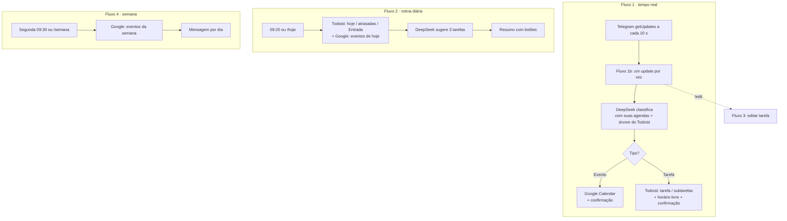

# Visão geral e arquitetura

## O que é o Chronos

Um agente de produtividade **auto-hospedado**. Você manda uma mensagem de texto ao seu bot no Telegram; o Chronos usa a IA do DeepSeek para decidir se é uma **tarefa** ou um **evento** e organiza tudo sozinho: tarefas no Todoist (no projeto, seção e posição certos da sua árvore de tarefas), eventos no Google Calendar (na agenda mais adequada). Todo dia ele envia um resumo; toda segunda, a agenda da semana.

O objetivo é reduzir o atrito de “anotar” a zero: uma frase solta vira algo no lugar certo, sem abrir app nenhum.

## Peças

| Camada | Tecnologia | Papel |
| --- | --- | --- |
| Orquestração | n8n (Docker, local) | motor de workflows e agendamento |
| Interface | Telegram Bot | entrada de mensagens e saída de respostas/botões |
| IA | DeepSeek API | classificação e extração estruturada (JSON); sugestões do dia |
| Tarefas | Todoist API | armazenamento e gestão das tarefas |
| Eventos | Google Calendar API | criar e ler eventos (credencial OAuth2 do n8n) |
| Segredos | `.env` | injetado no container, lido como `$env.*` |

## Fluxos

Os fluxos moram na mesma instância do n8n e dividem as mesmas credenciais. O Fluxo 1b também trata os botões e os comandos (`/hoje`, `/edit`, `/semana`, `/ajuda`). Sub-workflows utilitários (horário livre, buscar tarefa, criar subtarefas, pendências) evitam repetir lógica. Cada nó está descrito na [referência de workflows](../referencia/workflows.md).

## Como o Todoist é organizado

1. **Entrada (Inbox)** — destino padrão de capturas sem projeto claro.
2. **Seus projetos e seções** — criados por você no Todoist. A **descrição** de cada projeto e seção é o que a IA lê para decidir onde uma tarefa cabe — descreva-os bem.
3. **Decisão da IA** — a cada mensagem o n8n monta o mapa *Projeto › Seção › Tarefa › Subtarefa* do seu Todoist e a IA devolve **ids** (nunca nomes inventados). Veja [como a IA decide](ia-na-criacao-de-tarefas.md).
4. **Fallback** — id inexistente, projeto ou pai inválido: a tarefa cai na Entrada, com aviso, sem erro.

## Resiliência

- **Fila do Telegram:** com o Docker desligado, o Telegram retém as mensagens por até 24 h. Ao subir, o Chronos processa **todas**, em ordem, uma por vez, e só as confirma como lidas depois de processadas; falha → o offset não avança e a próxima varredura tenta de novo (máx. 3 vezes; na 4ª pula com aviso para não travar a fila).
- **Lock:** duas varreduras nunca processam o mesmo update (lock de 3 min na Data Table `chronos_estado`).
- **Sem derrubar a mensagem:** falhas de resposta ao Telegram, de subtarefas isoladas, de leitura do Google ou de métricas não fazem a mensagem ser reprocessada (evitaria tarefas duplicadas).
- **Google indisponível:** o Fluxo 1b avisa que não conseguiu criar o evento; o Fluxo 2 envia o resumo sem a agenda, com o motivo.
- **Agendamentos não são retroativos:** se a máquina estava desligada às 9h20, o resumo daquele dia não é enviado — `/hoje` e `/semana` recuperam.

## Limitações conhecidas

- Janela do horário livre fixa (08h–20h, slots de 60 min); tarefas sem duração contam 60 min. O encaixe considera só tarefas com hora do Todoist, não os eventos do Google.
- Agenda da semana: até 250 eventos por agenda (sem paginação); um evento aceito em duas agendas aparece duas vezes.
- As datas dos eventos são calculadas pela IA; datas inválidas não criam evento.
- Os textos do bot e dos prompts estão em português.

Para o que ficou de fora de propósito e as ideias futuras, veja [roteiro e ideias](roadmap-e-ideias.md).
